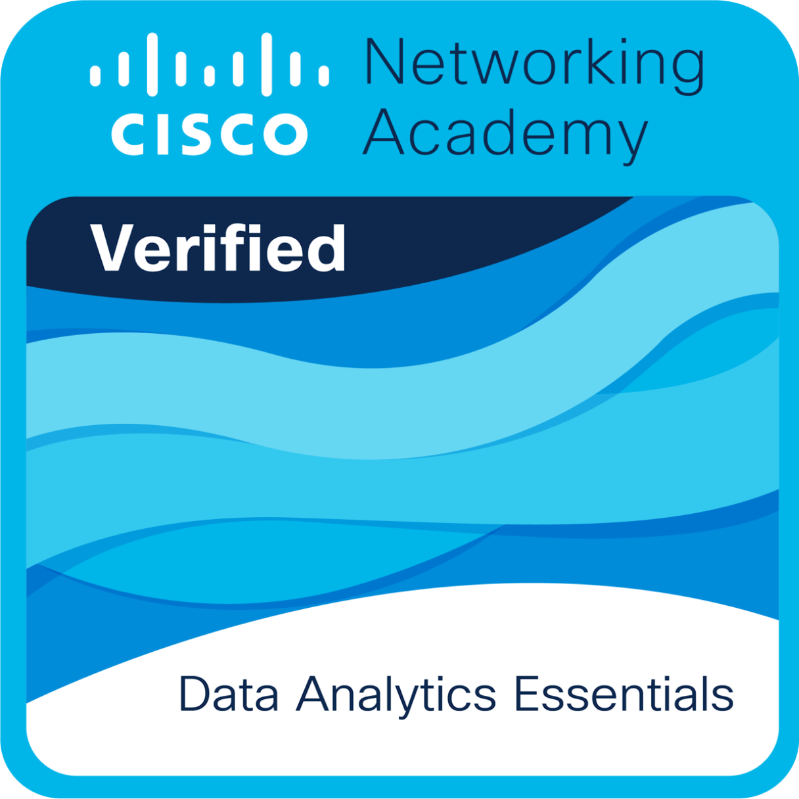

<a href="./README.md" lang="en">English</a> · <strong>Español</strong>

#  Rafael Estiven Uribe Álvarez

**Desarrollador de software · Backend e integración de datos**  
Medellín, Colombia

Soy ingeniero civil y estoy terminando Ingeniería Informática. He conectado software de facturación con la DIAN y modelado datos académicos. Busco oportunidades en backend e ingeniería de datos en Colombia y en equipos internacionales.

## Proyectos destacados

[RoadCare](#roadcare) · [Biblioteca Pro](#biblioteca-pro) · [Alerto](#alerto)

### RoadCare

**Mantenimiento vial · Proyecto académico en equipo**  
Python · FastAPI · React · PostgreSQL

Desarrollamos una aplicación web que ayuda a los inspectores a decidir qué daños en la vía atender primero. El puntaje tiene en cuenta la severidad, el tipo de daño y si el lugar es una zona crítica. Trabajé en el flujo de reparación, desde la asignación de la cuadrilla hasta la aprobación del cierre por un inspector o administrador.

[Código fuente][roadcare] · [Cálculo de prioridad][priority] · [Manual de usuario][road-guide]

### Biblioteca Pro

**Pruebas de extremo a extremo para un catálogo bibliotecario · Proyecto académico en equipo**  
Robot Framework · Selenium · Java · TestNG · Python

Automatizamos en el navegador tareas habituales de una biblioteca, desde buscar un libro por título o autor hasta comprobar que sigue en el catálogo al cancelar su eliminación. Las pruebas toman los datos de Excel. Mejoré la interfaz de Windows que usa el equipo para ejecutar las pruebas y revisar las capturas.

[Código e instalación][qa] · [Pruebas del catálogo][catalog-tests] · [Interfaz de Windows][qa-launcher]

### Alerto

**API de alertas ciudadanas para Medellín · Proyecto académico en equipo**  
C# · ASP.NET Core · Entity Framework Core · PostgreSQL · Redis

La API guarda lecturas meteorológicas de Open-Meteo y puede generar una alerta georreferenciada cuando el riesgo por lluvia es alto. Incorporé la configuración de Docker para levantar juntos la API, la base de datos y la caché. Una prueba de integración recorre el inicio de sesión, la creación de la alerta y su aprobación.

[Código fuente][alerto] · [Especificación OpenAPI][alerto-spec] · [Prueba del flujo de alertas][alerto-test]

## Competencias técnicas

 **Lenguajes** · Python, JavaScript, C#, Java y SQL.

 **Frameworks y bibliotecas** · FastAPI y React en RoadCare, ASP.NET Core y Entity Framework Core en Alerto, y Spring Boot en facturación electrónica.

 **Bases de datos y caché** · PostgreSQL para los registros de las aplicaciones y Redis para almacenar respuestas de la API en caché.

 **Desarrollo y pruebas** · Git, Docker Compose y OpenAPI, además de [pruebas de extremo a extremo en el navegador con Robot Framework y Selenium][qa].

 **Nube, redes y ciberseguridad** · Supabase para la programación de cursos universitarios, JWT para el acceso a las API y formación en Linux y seguridad de redes.

 **IA y aprendizaje automático** · En un curso de aprendizaje profundo usamos PyTorch y pix2pix para generar imágenes de aspecto satelital a partir de mapas. Comparamos los resultados al cambiar el peso de la pérdida L1.

## Experiencia y formación

**Politécnico Colombiano Jaime Isaza Cadavid · Análisis y arquitectura de datos**  
Analicé tendencias en registros académicos y elaboré informes institucionales. Como arquitecto de datos, modelé información de sistemas internos y API externas, y automaticé su validación y limpieza con Python y SQL.

**Eco-Tributario · Desarrollador full stack junior**  
Desarrollé la interfaz local de facturación y usé Spring Boot para conectar el sistema administrativo Saint con la DIAN en el proceso de facturación electrónica.

**Formación** · Ingeniero civil y estudiante de último semestre de Ingeniería Informática en el Politécnico Colombiano Jaime Isaza Cadavid. Admitido a la Maestría en Ingeniería - Ingeniería de Sistemas de la Universidad Nacional de Colombia.

## Certificaciones e insignias digitales

| Insignia | Credencial y emisor |
| :--: | :-- |
| [][badge-data] | **[Data Analytics Essentials][badge-data]** Cisco · Networking Academy |
| [][badge-linux] | **[Linux Essentials][badge-linux]** Cisco · Networking Academy |
| [][badge-ethical] | **[Ethical Hacker][badge-ethical]** Cisco · Networking Academy |
| [][badge-genai] | **[Critical Career Skills - Generative AI Foundations][badge-genai]** Certiport, a Pearson VUE business |
| [][badge-watson] | **[Creación de aplicaciones de IA con las API de Watson][badge-watson]** Coursera (programa SENATEC) |

## Contacto

[LinkedIn][linkedin] · [estiven9512@gmail.com][email] · [Perfil profesional en Himalayas][himalayas]

[roadcare]: https://github.com/EstivenUribe/RoadCare
[priority]: https://github.com/EstivenUribe/RoadCare/blob/main/backend/app/services/ai_priority.py
[road-guide]: https://github.com/EstivenUribe/RoadCare/blob/main/docs/manual_usuario.md
[catalog-tests]: https://github.com/EstivenUribe/test-roboframework/blob/main/robot/tests/02_catalogo.robot
[qa-launcher]: https://github.com/EstivenUribe/test-roboframework/blob/main/gui/launcher.py
[alerto]: https://github.com/EstivenUribe/Alerto
[alerto-spec]: https://github.com/EstivenUribe/Alerto/blob/main/alerto-openapi.yaml
[alerto-test]: https://github.com/EstivenUribe/Alerto/blob/main/tests/Alerto.IntegrationTests/AlertWorkflowTests.cs
[qa]: https://github.com/EstivenUribe/test-roboframework
[badge-data]: https://www.credly.com/badges/1fbcc50e-c05f-4293-bd6c-fbe96bf01fd8
[badge-linux]: https://www.credly.com/badges/60cba0d4-ddd4-47a2-8194-0f593347344d
[badge-ethical]: https://www.credly.com/badges/064f6c27-0a67-4558-b8df-3bf5637a909b
[badge-genai]: https://www.credly.com/badges/a139445c-dfc9-406d-8b25-26b90a69bdf1
[badge-watson]: https://www.credly.com/badges/9a5901c3-b913-41b9-ae86-4d5d372ff28b
[linkedin]: https://www.linkedin.com/in/rafaeluribealvarez/
[email]: mailto:estiven9512@gmail.com
[himalayas]: https://himalayas.app/@estivenuribealvarez
