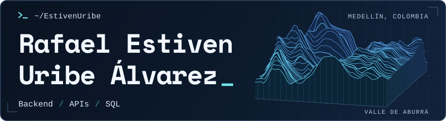
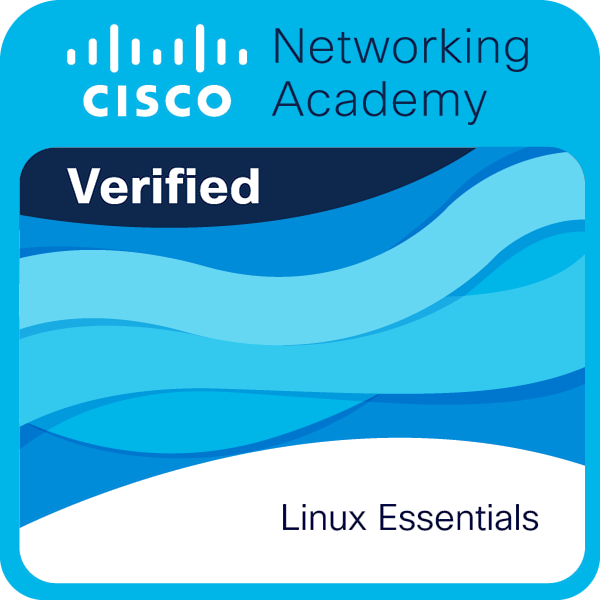
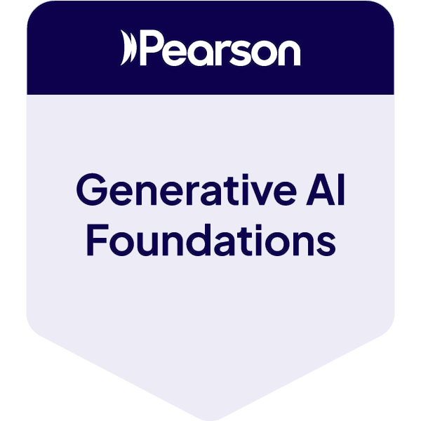
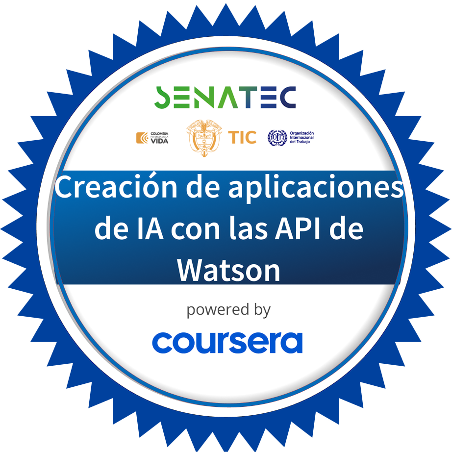
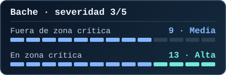

<samp><a href="./README.md" lang="en">English</a> · <strong>Español</strong></samp>

<h1><picture>
  <source media="(max-width: 680px)" srcset="./assets/identity/estiven-terminal-mobile.svg">
  <source media="(prefers-reduced-motion: no-preference)" srcset="./assets/identity/estiven-terminal-scan.svg">
  
</picture></h1>

  &nbsp;&nbsp;
  &nbsp;

<samp>Credenciales y emisores en Credly</samp>

- **[Data Analytics Essentials][badge-data]** · Cisco Networking Academy
- **[Linux Essentials][badge-linux]** · Cisco Networking Academy
- **[Ethical Hacker][badge-ethical]** · Cisco Networking Academy
- **[Critical Career Skills - Generative AI Foundations][badge-genai]** · Certiport (Pearson VUE)
- **[Creación de aplicaciones de IA con las API de Watson][badge-watson]** · Coursera (SENATEC)

**Soy desarrollador de software e ingeniero civil.** Integré un sistema de facturación con la DIAN y automaticé la validación de registros universitarios con Python y SQL. Estoy terminando Ingeniería Informática y busco oportunidades en backend e ingeniería de datos en Colombia y en el exterior.

## <samp>Proyectos destacados</samp>

[RoadCare](#roadcare) · [Biblioteca Pro](#biblioteca-pro) · [Alerto](#alerto)

### <samp>RoadCare</samp>

**¿Qué daño en la vía debería atender primero una cuadrilla?** <samp>Python · FastAPI · React · PostgreSQL</samp>

En la universidad desarrollamos una herramienta que prioriza los daños según su severidad, el tipo de daño y si la vía está en una zona crítica. [Trabajé en el flujo de reparación][road-work], desde la asignación de la cuadrilla hasta la aprobación del cierre por parte de un inspector o administrador.

[Repositorio][roadcare] · [Cálculo de prioridad][priority] · [Manual de usuario][road-guide]

### <samp>Biblioteca Pro</samp>

**¿El libro sigue en el catálogo si se cancela su eliminación?** <samp>Robot Framework · Selenium · Java · TestNG · Python</samp>

Es uno de los casos que automatizamos en el navegador, junto con las búsquedas por título y autor. Las pruebas toman sus datos de Excel. [Mejoré la interfaz de Windows][qa-work] que usa el equipo para ejecutarlas y revisar las capturas de pantalla.

[Repositorio e instalación][qa] · [Pruebas del catálogo][catalog-tests] · [Interfaz de Windows][qa-launcher]

### <samp>Alerto</samp>

**¿Cómo se convierte una lectura de lluvia en una alerta local?** <samp>C# · ASP.NET Core · Entity Framework Core · PostgreSQL · Redis</samp>

Nuestra API guarda lecturas de Open-Meteo y puede generar una alerta georreferenciada cuando hay riesgo alto por lluvias en Medellín. [Añadí la configuración de Docker][alert-work] para ejecutar juntos la API, la base de datos y la caché. Una prueba de integración recorre el inicio de sesión, la creación de la alerta y su aprobación.

[Repositorio][alerto] · [Especificación OpenAPI][alerto-spec] · [Prueba del flujo de alertas][alerto-test]

## <samp>Competencias técnicas</samp>

 **Lenguajes** · Python, JavaScript, C#, Java y SQL.

 **Frameworks** · FastAPI y React en RoadCare, ASP.NET Core y Entity Framework Core en Alerto, y Spring Boot en facturación electrónica.

 **Bases de datos y caché** · PostgreSQL para los registros de las aplicaciones y Redis para almacenar respuestas de la API en caché.

 **Desarrollo y pruebas** · Git, Docker Compose, OpenAPI y [pruebas de extremo a extremo con Robot Framework y Selenium][qa].

 **Nube, redes y seguridad** · Supabase para la programación de cursos universitarios, JWT para el acceso a la API y formación en Linux y seguridad de redes.

 **Aprendizaje automático** · En un curso de aprendizaje profundo usamos PyTorch y pix2pix para generar imágenes de aspecto satelital a partir de mapas. Comparamos los resultados al variar el peso de la pérdida L1.

## <samp>Experiencia y formación</samp>

**Politécnico Colombiano Jaime Isaza Cadavid · Análisis y arquitectura de datos** Analicé tendencias en registros académicos y preparé informes institucionales. Como arquitecto de datos, modelé información de sistemas internos y API externas y automaticé la validación y limpieza de datos con Python y SQL.

**Eco-Tributario · Desarrollador full stack junior** Desarrollé la interfaz local de facturación e integré el sistema administrativo Saint con la DIAN mediante Spring Boot para la facturación electrónica.

**Formación** · Ingeniero civil y estudiante de último semestre de Ingeniería Informática en el Politécnico Colombiano Jaime Isaza Cadavid. Admitido a la Maestría en Ingeniería - Ingeniería de Sistemas de la Universidad Nacional de Colombia.

## <samp>Contacto</samp>

[LinkedIn][linkedin] · [estiven9512@gmail.com][email] · [Perfil profesional en Himalayas][himalayas]

La portada muestra el relieve del Valle de Aburrá alrededor de Medellín. Datos de elevación de <a href="https://topotools.cr.usgs.gov/gmted_viewer/viewer.htm">USGS y NGA, GMTED2010</a>.

[roadcare]: https://github.com/EstivenUribe/RoadCare
[priority]: https://github.com/EstivenUribe/RoadCare/blob/main/backend/app/services/ai_priority.py
[road-guide]: https://github.com/EstivenUribe/RoadCare/blob/main/docs/manual_usuario.md
[catalog-tests]: https://github.com/EstivenUribe/test-roboframework/blob/main/robot/tests/02_catalogo.robot
[qa-launcher]: https://github.com/EstivenUribe/test-roboframework/blob/main/gui/launcher.py
[alerto]: https://github.com/EstivenUribe/Alerto
[alerto-spec]: https://github.com/EstivenUribe/Alerto/blob/main/alerto-openapi.yaml
[alerto-test]: https://github.com/EstivenUribe/Alerto/blob/main/tests/Alerto.IntegrationTests/AlertWorkflowTests.cs
[qa]: https://github.com/EstivenUribe/test-roboframework
[badge-data]: https://www.credly.com/badges/1fbcc50e-c05f-4293-bd6c-fbe96bf01fd8
[badge-linux]: https://www.credly.com/badges/60cba0d4-ddd4-47a2-8194-0f593347344d
[badge-ethical]: https://www.credly.com/badges/064f6c27-0a67-4558-b8df-3bf5637a909b
[badge-genai]: https://www.credly.com/badges/a139445c-dfc9-406d-8b25-26b90a69bdf1
[badge-watson]: https://www.credly.com/badges/9a5901c3-b913-41b9-ae86-4d5d372ff28b
[linkedin]: https://www.linkedin.com/in/rafaeluribealvarez/
[email]: mailto:estiven9512@gmail.com
[himalayas]: https://himalayas.app/@estivenuribealvarez
[road-work]: https://github.com/EstivenUribe/RoadCare/commit/7ddc2b8587e85e0f08a93039824f2dafd2d2b54f
[qa-work]: https://github.com/EstivenUribe/test-roboframework/commit/d967f6b1bd2eb03b1dae9db2554b4a3377ca8cd8
[alert-work]: https://github.com/EstivenUribe/Alerto/commit/384a84ac7c516d1fe3af4979eadafd0aad14305f
