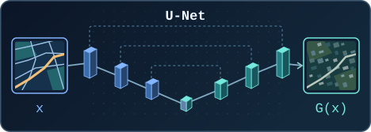
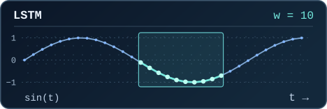
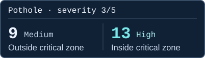

<!-- Spanish edition generated from README.es.md with tools/sync_spanish.py -->

<samp>Leer en español</samp>

[English](#english) · [Abrir el archivo en español](./README.es.md)

<h2><picture>
  <source media="(max-width: 680px) and (prefers-reduced-motion: no-preference)" srcset="./assets/identity/estiven-terminal-mobile-scan.svg">
  <source media="(max-width: 680px)" srcset="./assets/identity/estiven-terminal-mobile.svg">
  <source media="(prefers-reduced-motion: no-preference)" srcset="./assets/identity/estiven-terminal-scan.svg">
  
</picture></h2>

  &nbsp;&nbsp;
  &nbsp;

<samp>Credenciales y emisores en Credly</samp>

- **[Data Analytics Essentials](https://www.credly.com/badges/1fbcc50e-c05f-4293-bd6c-fbe96bf01fd8)** · Cisco Networking Academy
- **[Linux Essentials](https://www.credly.com/badges/60cba0d4-ddd4-47a2-8194-0f593347344d)** · Cisco Networking Academy
- **[Ethical Hacker](https://www.credly.com/badges/064f6c27-0a67-4558-b8df-3bf5637a909b)** · Cisco Networking Academy
- **[Critical Career Skills - Generative AI Foundations](https://www.credly.com/badges/a139445c-dfc9-406d-8b25-26b90a69bdf1)** · Certiport (Pearson VUE)
- **[Creación de aplicaciones de IA con las API de Watson](https://www.credly.com/badges/9a5901c3-b913-41b9-ae86-4d5d372ff28b)** · Coursera (SENATEC)

**Soy desarrollador de software y trabajo en sistemas backend e integración de datos.** Integré un sistema de facturación con la DIAN y automaticé la validación de registros universitarios con Python y SQL. Curso la Especialización en Inteligencia Artificial en la Universidad Nacional de Colombia.

## <samp>Proyectos destacados</samp>

[RoadCare](#es-roadcare) · [Biblioteca Pro](#es-biblioteca-pro) · [Alerto](#es-alerto)

### <samp>RoadCare</samp> · ¿Qué daño en la vía debería atender primero una cuadrilla?

<samp>Python · FastAPI · React · PostgreSQL</samp>

En la universidad desarrollamos una herramienta que prioriza los daños según su severidad, el tipo de daño y si la vía está en una zona crítica. [Trabajé en el flujo de reparación](https://github.com/EstivenUribe/RoadCare/commit/7ddc2b8587e85e0f08a93039824f2dafd2d2b54f), desde la asignación de la cuadrilla hasta la aprobación del cierre por parte de un inspector o administrador.

<picture>
  <source media="(prefers-reduced-motion: no-preference)" srcset="./assets/roadcare-priority-motion.es.svg">
  
</picture>

[Repositorio](https://github.com/EstivenUribe/RoadCare) · [Cálculo de prioridad](https://github.com/EstivenUribe/RoadCare/blob/main/backend/app/services/ai_priority.py) · [Manual de usuario](https://github.com/EstivenUribe/RoadCare/blob/main/docs/manual_usuario.md)

### <samp>Biblioteca Pro</samp> · ¿El libro sigue en el catálogo si se cancela su eliminación?

<samp>Robot Framework · Selenium · Java · TestNG · Python</samp>

Es uno de los casos que automatizamos en el navegador, junto con las búsquedas por título y autor. Las pruebas toman sus datos de Excel. [Mejoré la interfaz de Windows](https://github.com/EstivenUribe/test-roboframework/commit/d967f6b1bd2eb03b1dae9db2554b4a3377ca8cd8) que usa el equipo para ejecutarlas y revisar las capturas de pantalla.

[Repositorio e instalación](https://github.com/EstivenUribe/test-roboframework) · [Pruebas del catálogo](https://github.com/EstivenUribe/test-roboframework/blob/main/robot/tests/02_catalogo.robot) · [Interfaz de Windows](https://github.com/EstivenUribe/test-roboframework/blob/main/gui/launcher.py)

### <samp>Alerto</samp> · ¿Cómo se convierte una lectura de lluvia en una alerta local?

<samp>C# · ASP.NET Core · Entity Framework Core · PostgreSQL · Redis</samp>

Nuestra API guarda lecturas de Open-Meteo y puede generar una alerta georreferenciada cuando hay riesgo alto por lluvias en Medellín. [Añadí la configuración de Docker](https://github.com/EstivenUribe/Alerto/commit/384a84ac7c516d1fe3af4979eadafd0aad14305f) para ejecutar juntos la API, la base de datos y la caché. Una prueba de integración recorre el inicio de sesión, la creación de la alerta y su aprobación.

[Repositorio](https://github.com/EstivenUribe/Alerto) · [Especificación OpenAPI](https://github.com/EstivenUribe/Alerto/blob/main/alerto-openapi.yaml) · [Prueba del flujo de alertas](https://github.com/EstivenUribe/Alerto/blob/main/tests/Alerto.IntegrationTests/AlertWorkflowTests.cs)

## <samp>IA aplicada</samp>

**¿Cómo se genera una vista aérea a partir de un mapa de calles?** <samp>PyTorch · pix2pix · U-Net</samp>

En un proyecto de clase, mi equipo hizo una prueba piloto con pix2pix usando pares de mapas y fotos aéreas. Cambiamos de 100 a 10 el peso del error píxel a píxel (L1) y comparamos ambos modelos con los mismos mapas. El esquema muestra cómo la U-Net conserva detalles de las calles al pasarlos del codificador al decodificador.

<picture>
  <source media="(prefers-reduced-motion: no-preference)" srcset="./assets/ai/pix2pix-motion.svg">
  
</picture>

[Volver a ver la U-Net en movimiento](https://raw.githubusercontent.com/EstivenUribe/EstivenUribe/main/assets/ai/pix2pix-motion.svg) · [Resultados del piloto (CSV)](./assets/ai/pix2pix-pilot.csv) · [Artículo original](https://phillipi.github.io/pix2pix/)

## <samp>Competencias técnicas</samp>

 **Lenguajes** · Python, JavaScript, C#, Java y SQL.

 **Frameworks** · FastAPI y React en RoadCare, ASP.NET Core y Entity Framework Core en Alerto, y Spring Boot en facturación electrónica.

 **Bases de datos y caché** · PostgreSQL para los registros de las aplicaciones y Redis para almacenar respuestas de la API en caché.

 **Desarrollo y pruebas** · Git, Docker Compose, OpenAPI y [pruebas de extremo a extremo con Robot Framework y Selenium](https://github.com/EstivenUribe/test-roboframework).

 **Nube, redes y seguridad** · Supabase para la programación de cursos universitarios, JWT para el acceso a la API y formación en Linux y seguridad de redes.

 **Aprendizaje automático** · PyTorch para transformar imágenes y TensorFlow/Keras para pronosticar secuencias.

## <samp>Experiencia y formación</samp>

**Eco-Tributario · Desarrollador full stack junior** Desarrollé la interfaz local de facturación e integré el sistema administrativo Saint con la DIAN mediante Spring Boot para la facturación electrónica.

**Politécnico Colombiano Jaime Isaza Cadavid · Análisis y arquitectura de datos** Analicé tendencias en registros académicos y preparé informes institucionales. Como arquitecto de datos, modelé información de sistemas internos y API externas y automaticé la validación y limpieza de datos con Python y SQL.

**Universidad Nacional de Colombia · Especialización en Inteligencia Artificial (en curso)** En un ejercicio de aprendizaje profundo usé una LSTM para pronosticar una onda seno. Cada predicción volvía a entrar al modelo para calcular la siguiente. En los primeros 40 pasos, la raíz del error cuadrático medio fue **0,0206 con diez muestras previas** y **1,0835 con una sola**. Una misma altura puede corresponder a un tramo ascendente o descendente de la onda.

<picture>
  <source media="(prefers-reduced-motion: no-preference)" srcset="./assets/ai/lstm-window-motion.svg">
  
</picture>

[Volver a ver la ventana en movimiento](https://raw.githubusercontent.com/EstivenUribe/EstivenUribe/main/assets/ai/lstm-window-motion.svg) · [Resultados del ejercicio (CSV)](./assets/ai/lstm-window-results.csv)

**Ingeniería Informática** · Curso el último semestre en el Politécnico Colombiano Jaime Isaza Cadavid. También soy ingeniero civil.

## <samp>Contacto</samp>

Busco oportunidades en desarrollo backend e ingeniería de datos en Colombia y en equipos internacionales.

[LinkedIn](https://www.linkedin.com/in/rafaeluribealvarez/) · [estiven9512@gmail.com](mailto:estiven9512@gmail.com) · [Perfil profesional en Himalayas](https://himalayas.app/@estivenuribealvarez)

La portada muestra el relieve de Medellín y sus alrededores. Datos de elevación de <a href="https://topotools.cr.usgs.gov/gmted_viewer/viewer.htm">USGS y NGA, GMTED2010</a>.

<!-- End of the in-page Spanish edition -->

<h1><picture>
  <source media="(max-width: 680px) and (prefers-reduced-motion: no-preference)" srcset="./assets/identity/estiven-terminal-mobile-scan.svg">
  <source media="(max-width: 680px)" srcset="./assets/identity/estiven-terminal-mobile.svg">
  <source media="(prefers-reduced-motion: no-preference)" srcset="./assets/identity/estiven-terminal-scan.svg">
  
</picture></h1>

  &nbsp;&nbsp;
  &nbsp;

<samp>Credentials and issuers on Credly</samp>

- **[Data Analytics Essentials][badge-data]** · Cisco Networking Academy
- **[Linux Essentials][badge-linux]** · Cisco Networking Academy
- **[Ethical Hacker][badge-ethical]** · Cisco Networking Academy
- **[Critical Career Skills - Generative AI Foundations][badge-genai]** · Certiport (Pearson VUE)
- **[Creación de aplicaciones de IA con las API de Watson][badge-watson]** · Coursera (SENATEC)

**I’m a software developer focused on backend systems and data integration.** I connected an invoicing system to Colombia’s tax authority (DIAN) and automated checks on university records with Python and SQL. I’m pursuing a postgraduate specialization in artificial intelligence at Universidad Nacional de Colombia.

## <samp>Selected projects</samp>

[RoadCare](#roadcare) · [Biblioteca Pro](#biblioteca-pro) · [Alerto](#alerto)

### <samp>RoadCare</samp>

**Which road defect should a crew repair first?** <samp>Python · FastAPI · React · PostgreSQL</samp>

Our university team built a tool that ranks road damage by severity, type and whether it falls within a critical zone. I [worked on the repair workflow][road-work], from assigning a crew to letting an inspector or administrator sign off on the completed repair.

<picture>
  <source media="(prefers-reduced-motion: no-preference)" srcset="./assets/roadcare-priority-motion.en.svg">
  
</picture>

[Repository][roadcare] · [Priority calculation][priority] · [User guide in Spanish][road-guide]

### <samp>Biblioteca Pro</samp>

**Does a book stay in the catalog when someone cancels a deletion?** <samp>Robot Framework · Selenium · Java · TestNG · Python</samp>

That’s one of the cases our team automated in the browser, alongside searches by title and author. The suites read their test data from Excel. I [improved the Windows launcher][qa-work] that runs the tests and lets the team inspect screenshots.

[Repository and setup][qa] · [Catalog test cases][catalog-tests] · [Windows launcher][qa-launcher]

### <samp>Alerto</samp>

**How do rainfall readings become a local alert?** <samp>C# · ASP.NET Core · Entity Framework Core · PostgreSQL · Redis</samp>

Our API stores readings from Open-Meteo and can create a geolocated alert when rainfall risk is high in Medellín. I [added the Docker configuration][alert-work] to run the API, database and cache together. An integration test follows an alert from sign-in through creation and approval.

[Repository][alerto] · [OpenAPI specification][alerto-spec] · [Alert workflow test][alerto-test]

## <samp>Applied AI</samp>

**How much can a street map tell a model about an aerial photo?** <samp>PyTorch · pix2pix · U-Net</samp>

In a course project, my team ran a pix2pix pilot on paired maps and aerial photos. We changed the weight of the pixel-by-pixel error (L1) from 100 to 10 and compared both models on the same maps. The diagram shows how the U-Net passes street detail from its encoder to its decoder.

<picture>
  <source media="(prefers-reduced-motion: no-preference)" srcset="./assets/ai/pix2pix-motion.svg">
  
</picture>

[Replay the U-Net animation][replay-pix2pix] · [Pilot results (CSV)](./assets/ai/pix2pix-pilot.csv) · [Original paper][pix2pix-paper]

## <samp>Technical skills</samp>

 **Languages** · Python, JavaScript, C#, Java and SQL.

 **Frameworks** · FastAPI and React for RoadCare, ASP.NET Core and Entity Framework Core for Alerto, and Spring Boot for electronic invoicing.

 **Databases and caching** · PostgreSQL for application records and Redis for cached API responses.

 **Development and testing** · Git, Docker Compose, OpenAPI and [end-to-end browser testing with Robot Framework and Selenium][qa].

 **Cloud, networks and security** · Supabase for university course scheduling, JWT for API access, and coursework in Linux and network security.

 **Machine learning** · PyTorch for image-to-image translation and TensorFlow/Keras for sequence forecasting.

## <samp>Experience and education</samp>

**Eco-Tributario · Junior full-stack developer** I built the local invoicing interface and used Spring Boot to connect the Saint business system to DIAN for electronic invoicing.

**Politécnico Colombiano Jaime Isaza Cadavid · Data analysis and architecture** I analyzed trends in academic records and prepared institutional reports. In my data architecture role, I modeled data from internal systems and external APIs and automated validation and cleaning with Python and SQL.

**Universidad Nacional de Colombia · Postgraduate specialization in artificial intelligence (in progress)** In a deep learning exercise, I used an LSTM to forecast a sine wave, feeding each prediction back into the model. Over the first 40 forecast steps, the root mean squared error was **0.0206 with ten previous samples** and **1.0835 with one**. A single height on the wave can belong to either a rising or a falling segment.

<picture>
  <source media="(prefers-reduced-motion: no-preference)" srcset="./assets/ai/lstm-window-motion.svg">
  
</picture>

[Replay the sliding window][replay-lstm] · [Experiment results (CSV)](./assets/ai/lstm-window-results.csv)

**Informatics Engineering** · Final semester at Politécnico Colombiano Jaime Isaza Cadavid. I also hold a degree in Civil Engineering.

## <samp>Contact</samp>

I’m interested in backend development and data engineering roles in Colombia and abroad.

[LinkedIn][linkedin] · [estiven9512@gmail.com][email] · [Himalayas professional profile][himalayas]

The cover shows the terrain around Medellín. Elevation data from <a href="https://topotools.cr.usgs.gov/gmted_viewer/viewer.htm">USGS and NGA, GMTED2010</a>.

[roadcare]: https://github.com/EstivenUribe/RoadCare
[priority]: https://github.com/EstivenUribe/RoadCare/blob/main/backend/app/services/ai_priority.py
[road-guide]: https://github.com/EstivenUribe/RoadCare/blob/main/docs/manual_usuario.md
[catalog-tests]: https://github.com/EstivenUribe/test-roboframework/blob/main/robot/tests/02_catalogo.robot
[qa-launcher]: https://github.com/EstivenUribe/test-roboframework/blob/main/gui/launcher.py
[alerto]: https://github.com/EstivenUribe/Alerto
[alerto-spec]: https://github.com/EstivenUribe/Alerto/blob/main/alerto-openapi.yaml
[alerto-test]: https://github.com/EstivenUribe/Alerto/blob/main/tests/Alerto.IntegrationTests/AlertWorkflowTests.cs
[qa]: https://github.com/EstivenUribe/test-roboframework
[badge-data]: https://www.credly.com/badges/1fbcc50e-c05f-4293-bd6c-fbe96bf01fd8
[badge-linux]: https://www.credly.com/badges/60cba0d4-ddd4-47a2-8194-0f593347344d
[badge-ethical]: https://www.credly.com/badges/064f6c27-0a67-4558-b8df-3bf5637a909b
[badge-genai]: https://www.credly.com/badges/a139445c-dfc9-406d-8b25-26b90a69bdf1
[badge-watson]: https://www.credly.com/badges/9a5901c3-b913-41b9-ae86-4d5d372ff28b
[linkedin]: https://www.linkedin.com/in/rafaeluribealvarez/
[email]: mailto:estiven9512@gmail.com
[himalayas]: https://himalayas.app/@estivenuribealvarez
[road-work]: https://github.com/EstivenUribe/RoadCare/commit/7ddc2b8587e85e0f08a93039824f2dafd2d2b54f
[qa-work]: https://github.com/EstivenUribe/test-roboframework/commit/d967f6b1bd2eb03b1dae9db2554b4a3377ca8cd8
[alert-work]: https://github.com/EstivenUribe/Alerto/commit/384a84ac7c516d1fe3af4979eadafd0aad14305f
[pix2pix-paper]: https://phillipi.github.io/pix2pix/
[replay-pix2pix]: https://raw.githubusercontent.com/EstivenUribe/EstivenUribe/main/assets/ai/pix2pix-motion.svg
[replay-lstm]: https://raw.githubusercontent.com/EstivenUribe/EstivenUribe/main/assets/ai/lstm-window-motion.svg
