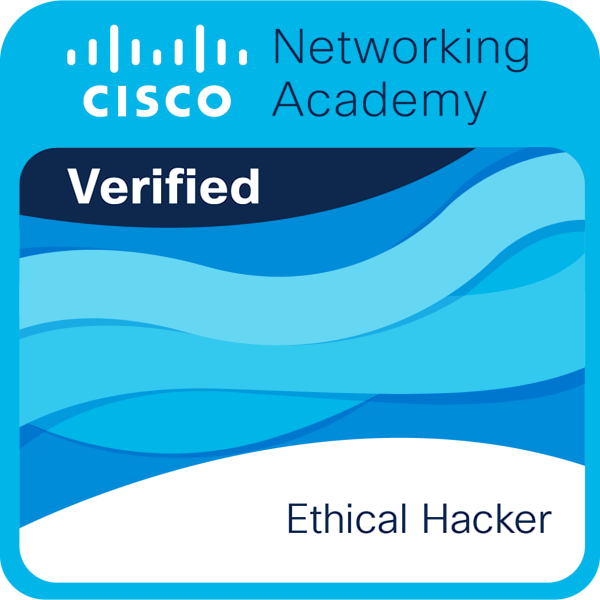

<strong>English</strong> · <a href="./README.es.md" lang="es">Español</a>

#  Rafael Estiven Uribe Álvarez

**Software developer · Backend and data integration**  
Medellín, Colombia

I’m a civil engineer completing a second degree in Informatics Engineering. I’ve connected billing software to Colombia’s tax authority and modeled university data. I’m looking for backend and data engineering roles in Colombia and on international teams.

## Featured projects

[RoadCare](#roadcare) · [Biblioteca Pro](#biblioteca-pro) · [Alerto](#alerto)

### RoadCare

**Road maintenance · Academic team project**  
Python · FastAPI · React · PostgreSQL

We built a web app that helps inspectors decide which road damage to address first. Its priority score accounts for severity, damage type and whether the site is in a critical zone. I worked on the repair workflow, from assigning a crew to having an inspector or administrator sign off on the completed work.

[Source code][roadcare] · [Priority calculation][priority] · [User guide (Spanish)][road-guide]

### Biblioteca Pro

**End-to-end testing for a library catalog · Academic team project**  
Robot Framework · Selenium · Java · TestNG · Python

We automated browser tests for everyday library tasks, from finding a book by title or author to checking that canceling a deletion keeps it in the catalog. The suites read test cases from Excel. I improved the Windows launcher the team uses to run the tests and inspect screenshots.

[Source code and setup][qa] · [Catalog tests][catalog-tests] · [Windows launcher][qa-launcher]

### Alerto

**Civic alert API for Medellín · Academic team project**  
C# · ASP.NET Core · Entity Framework Core · PostgreSQL · Redis

The API records weather readings from Open-Meteo and can create a geolocated alert when rainfall risk is high. I added the Docker setup that runs the API, database and cache together. An integration test follows an alert from sign-in through creation and approval.

[Source code][alerto] · [OpenAPI specification][alerto-spec] · [Alert workflow test][alerto-test]

## Technical skills

 **Languages** · Python, JavaScript, C#, Java and SQL.

 **Frameworks and libraries** · FastAPI and React for RoadCare, ASP.NET Core and Entity Framework Core for Alerto, and Spring Boot for electronic invoicing.

 **Databases and caching** · PostgreSQL for application records and Redis for cached API responses.

 **Development and testing** · Git, Docker Compose and OpenAPI, plus [end-to-end browser tests with Robot Framework and Selenium][qa].

 **Cloud, networking and security** · Supabase for university course scheduling, JWT for API access, and coursework in Linux and network security.

 **AI and machine learning** · In a deep learning course, my team used PyTorch and pix2pix to translate maps into satellite-style images. We compared the results when we changed the weight of the L1 loss.

## Experience and education

**Politécnico Colombiano Jaime Isaza Cadavid · Data analysis and architecture**  
I analyzed trends in academic records and prepared institutional reports. In my data architecture role, I modeled data from internal systems and external APIs and automated data validation and cleaning with Python and SQL.

**Eco-Tributario · Junior full-stack developer**  
I developed the local invoicing interface and used Spring Boot to connect the Saint business system to DIAN, Colombia’s tax authority, for electronic invoicing.

**Education** · Civil Engineering degree and final-semester Informatics Engineering studies at Politécnico Colombiano Jaime Isaza Cadavid. Admitted to the master’s program in Systems Engineering at Universidad Nacional de Colombia.

## Certifications & digital badges

| Badge | Credential and issuer |
| :--: | :-- |
| [][badge-data] | **[Data Analytics Essentials][badge-data]** Cisco · Networking Academy |
| [][badge-linux] | **[Linux Essentials][badge-linux]** Cisco · Networking Academy |
| [][badge-ethical] | **[Ethical Hacker][badge-ethical]** Cisco · Networking Academy |
| [][badge-genai] | **[Critical Career Skills - Generative AI Foundations][badge-genai]** Certiport, a Pearson VUE business |
| [][badge-watson] | **[Creación de aplicaciones de IA con las API de Watson][badge-watson]** Coursera (SENATEC program) |

## Contact

[LinkedIn][linkedin] · [estiven9512@gmail.com][email] · [Himalayas professional profile][himalayas]

[roadcare]: https://github.com/EstivenUribe/RoadCare
[priority]: https://github.com/EstivenUribe/RoadCare/blob/main/backend/app/services/ai_priority.py
[road-guide]: https://github.com/EstivenUribe/RoadCare/blob/main/docs/manual_usuario.md
[catalog-tests]: https://github.com/EstivenUribe/test-roboframework/blob/main/robot/tests/02_catalogo.robot
[qa-launcher]: https://github.com/EstivenUribe/test-roboframework/blob/main/gui/launcher.py
[alerto]: https://github.com/EstivenUribe/Alerto
[alerto-spec]: https://github.com/EstivenUribe/Alerto/blob/main/alerto-openapi.yaml
[alerto-test]: https://github.com/EstivenUribe/Alerto/blob/main/tests/Alerto.IntegrationTests/AlertWorkflowTests.cs
[qa]: https://github.com/EstivenUribe/test-roboframework
[badge-data]: https://www.credly.com/badges/1fbcc50e-c05f-4293-bd6c-fbe96bf01fd8
[badge-linux]: https://www.credly.com/badges/60cba0d4-ddd4-47a2-8194-0f593347344d
[badge-ethical]: https://www.credly.com/badges/064f6c27-0a67-4558-b8df-3bf5637a909b
[badge-genai]: https://www.credly.com/badges/a139445c-dfc9-406d-8b25-26b90a69bdf1
[badge-watson]: https://www.credly.com/badges/9a5901c3-b913-41b9-ae86-4d5d372ff28b
[linkedin]: https://www.linkedin.com/in/rafaeluribealvarez/
[email]: mailto:estiven9512@gmail.com
[himalayas]: https://himalayas.app/@estivenuribealvarez
