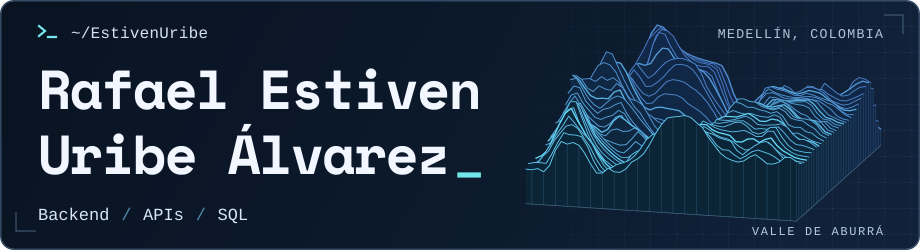
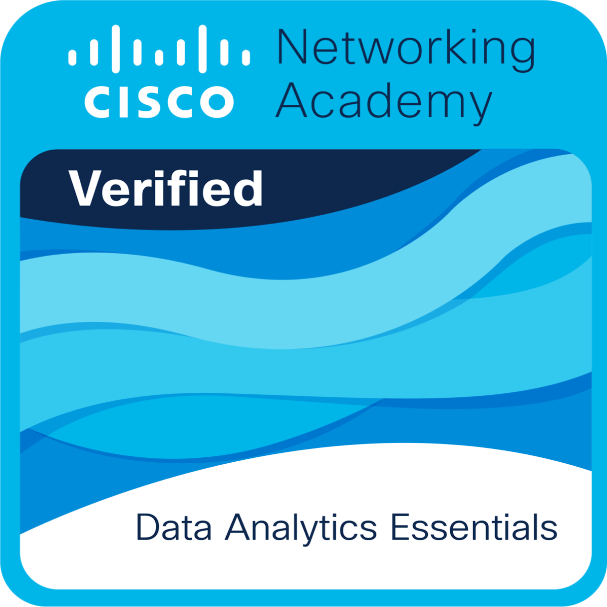
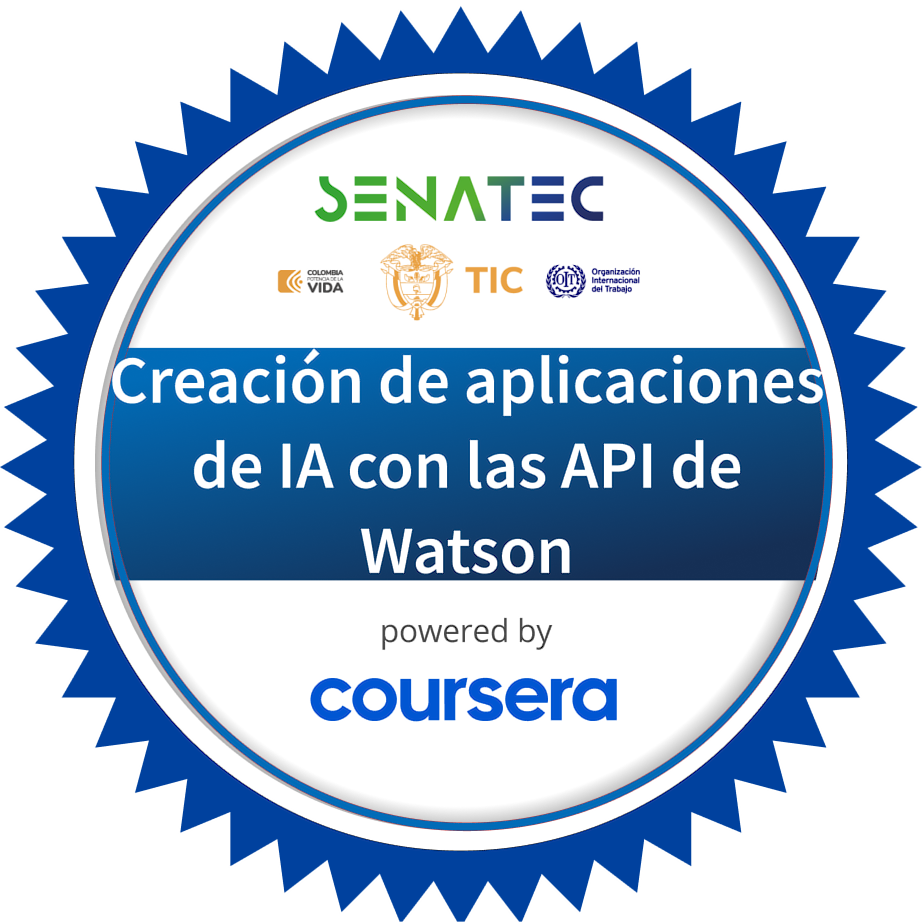

<samp><strong>English</strong> · <a href="./README.es.md" lang="es">Español</a></samp>

<h1><picture>
  <source media="(max-width: 680px)" srcset="./assets/identity/estiven-terminal-mobile.svg">
  <source media="(prefers-reduced-motion: no-preference)" srcset="./assets/identity/estiven-terminal-scan.svg">
  
</picture></h1>

  &nbsp;&nbsp;
  &nbsp;

<samp>Credentials and issuers on Credly</samp>

- **[Data Analytics Essentials][badge-data]** · Cisco Networking Academy
- **[Linux Essentials][badge-linux]** · Cisco Networking Academy
- **[Ethical Hacker][badge-ethical]** · Cisco Networking Academy
- **[Critical Career Skills - Generative AI Foundations][badge-genai]** · Certiport (Pearson VUE)
- **[Creación de aplicaciones de IA con las API de Watson][badge-watson]** · Coursera (SENATEC)

**I’m a software developer with a civil engineering background.** I connected a billing system to Colombia’s tax authority (DIAN) and automated checks on university records with Python and SQL. I’m finishing a second degree in Informatics Engineering and looking for backend and data engineering roles in Colombia and abroad.

## <samp>Selected projects</samp>

[RoadCare](#roadcare) · [Biblioteca Pro](#biblioteca-pro) · [Alerto](#alerto)

### <samp>RoadCare</samp>

**Which road defect should a crew repair first?** <samp>Python · FastAPI · React · PostgreSQL</samp>

Our university team built a tool that ranks road damage by severity, type and whether it falls within a critical zone. I [worked on the repair workflow][road-work], from assigning a crew to letting an inspector or administrator sign off on the completed repair.

[Repository][roadcare] · [Priority calculation][priority] · [User guide in Spanish][road-guide]

### <samp>Biblioteca Pro</samp>

**Does a book stay in the catalog when someone cancels a deletion?** <samp>Robot Framework · Selenium · Java · TestNG · Python</samp>

That’s one of the cases our team automated in the browser, alongside searches by title and author. The suites read their test data from Excel. I [improved the Windows launcher][qa-work] that runs the tests and lets the team inspect screenshots.

[Repository and setup][qa] · [Catalog test cases][catalog-tests] · [Windows launcher][qa-launcher]

### <samp>Alerto</samp>

**How do rainfall readings become a local alert?** <samp>C# · ASP.NET Core · Entity Framework Core · PostgreSQL · Redis</samp>

Our API stores readings from Open-Meteo and can create a geolocated alert when rainfall risk is high in Medellín. I [added the Docker configuration][alert-work] to run the API, database and cache together. An integration test follows an alert from sign-in through creation and approval.

[Repository][alerto] · [OpenAPI specification][alerto-spec] · [Alert workflow test][alerto-test]

## <samp>Technical skills</samp>

 **Languages** · Python, JavaScript, C#, Java and SQL.

 **Frameworks** · FastAPI and React for RoadCare, ASP.NET Core and Entity Framework Core for Alerto, and Spring Boot for electronic invoicing.

 **Databases and caching** · PostgreSQL for application records and Redis for cached API responses.

 **Development and testing** · Git, Docker Compose, OpenAPI and [end-to-end browser testing with Robot Framework and Selenium][qa].

 **Cloud, networks and security** · Supabase for university course scheduling, JWT for API access, and coursework in Linux and network security.

 **Machine learning** · In a deep learning course, my team used PyTorch and pix2pix to turn maps into satellite-style images. We compared results at different L1 loss weights.

## <samp>Experience and education</samp>

**Politécnico Colombiano Jaime Isaza Cadavid · Data analysis and architecture** I analyzed trends in academic records and prepared institutional reports. In my data architecture role, I modeled data from internal systems and external APIs and automated validation and cleaning with Python and SQL.

**Eco-Tributario · Junior full-stack developer** I built the local invoicing interface and used Spring Boot to connect the Saint business system to DIAN for electronic invoicing.

**Education** · Civil Engineering degree and final-semester Informatics Engineering studies at Politécnico Colombiano Jaime Isaza Cadavid. Admitted to the master’s program in Systems Engineering at Universidad Nacional de Colombia.

## <samp>Contact</samp>

[LinkedIn][linkedin] · [estiven9512@gmail.com][email] · [Himalayas professional profile][himalayas]

The cover shows the terrain of the Valle de Aburrá around Medellín. Elevation data from <a href="https://topotools.cr.usgs.gov/gmted_viewer/viewer.htm">USGS and NGA, GMTED2010</a>.

[roadcare]: https://github.com/EstivenUribe/RoadCare
[priority]: https://github.com/EstivenUribe/RoadCare/blob/main/backend/app/services/ai_priority.py
[road-guide]: https://github.com/EstivenUribe/RoadCare/blob/main/docs/manual_usuario.md
[catalog-tests]: https://github.com/EstivenUribe/test-roboframework/blob/main/robot/tests/02_catalogo.robot
[qa-launcher]: https://github.com/EstivenUribe/test-roboframework/blob/main/gui/launcher.py
[alerto]: https://github.com/EstivenUribe/Alerto
[alerto-spec]: https://github.com/EstivenUribe/Alerto/blob/main/alerto-openapi.yaml
[alerto-test]: https://github.com/EstivenUribe/Alerto/blob/main/tests/Alerto.IntegrationTests/AlertWorkflowTests.cs
[qa]: https://github.com/EstivenUribe/test-roboframework
[badge-data]: https://www.credly.com/badges/1fbcc50e-c05f-4293-bd6c-fbe96bf01fd8
[badge-linux]: https://www.credly.com/badges/60cba0d4-ddd4-47a2-8194-0f593347344d
[badge-ethical]: https://www.credly.com/badges/064f6c27-0a67-4558-b8df-3bf5637a909b
[badge-genai]: https://www.credly.com/badges/a139445c-dfc9-406d-8b25-26b90a69bdf1
[badge-watson]: https://www.credly.com/badges/9a5901c3-b913-41b9-ae86-4d5d372ff28b
[linkedin]: https://www.linkedin.com/in/rafaeluribealvarez/
[email]: mailto:estiven9512@gmail.com
[himalayas]: https://himalayas.app/@estivenuribealvarez
[road-work]: https://github.com/EstivenUribe/RoadCare/commit/7ddc2b8587e85e0f08a93039824f2dafd2d2b54f
[qa-work]: https://github.com/EstivenUribe/test-roboframework/commit/d967f6b1bd2eb03b1dae9db2554b4a3377ca8cd8
[alert-work]: https://github.com/EstivenUribe/Alerto/commit/384a84ac7c516d1fe3af4979eadafd0aad14305f
